# shaderdemo

GLSL 片元着色器学习练习集合：从纯色、几何形状、坐标变换，到波纹、域扭曲与 FBM 噪声。全部为单文件 `.frag`，使用 **glslViewer** 实时预览。

## 环境要求

- [glslViewer](https://github.com/patriciogonzalezvivo/glslViewer)（支持 macOS / Linux / Windows）
- macOS 安装：

```bash
brew install patriciogonzalezvivo/glslviewer/glslviewer
```

## 快速开始

```bash
# 在项目目录下直接运行任意 .frag
glslViewer 006circleshape.frag

# 指定窗口尺寸
glslViewer 018rainbowswirl.frag -w 800 -h 600
```

常用快捷键：`空格` 暂停 / 继续动画，`ESC` 退出。

## 固定骨架

每个着色器都包含精度声明、内置 uniform 和 `main` 入口：

```glsl
#ifdef GL_ES
precision mediump float;
#endif

uniform vec2  u_resolution; // 窗口宽高
uniform float u_time;      // 启动后经过的秒数，动画驱动来源

void main() {
    vec2 coord = gl_FragCoord.xy / u_resolution; // 归一化坐标 [0,1]
    // 计算颜色...
    gl_FragColor = vec4(r, g, b, 1.0);
}
```

GPU 对屏幕上每个像素各执行一次 `main`，着色器的本质是为每个像素计算颜色。

## 着色器清单

19 个着色器的实时截图见 `screenshots/`，下图为总览：

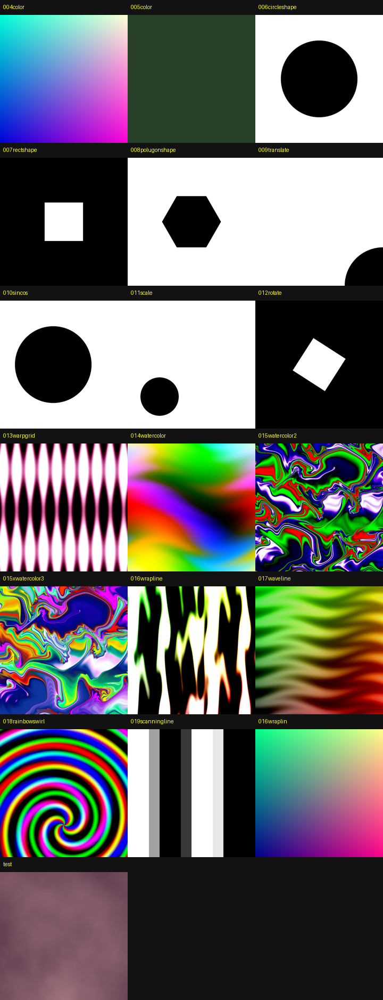

### 1. 基础颜色

| 文件              | 效果预览                                               | 内容                                      | 知识点                   |
| --------------- | -------------------------------------------------- | --------------------------------------- | --------------------- |
| `005color.frag` |  | 固定纯色（最简骨架）                              | `vec3` / `vec4`、alpha |
| `004color.frag` | 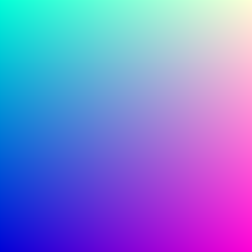 | 归一化坐标映射 RGB，B 通道由 `abs(sin(u_time))` 驱动 | 坐标 → 颜色映射、时间          |

### 2. 几何形状（step + 距离 / 角度）

| 文件                     | 效果预览                                                      | 内容   | 知识点                       |
| ---------------------- | --------------------------------------------------------- | ---- | ------------------------- |
| `006circleshape.frag`  | 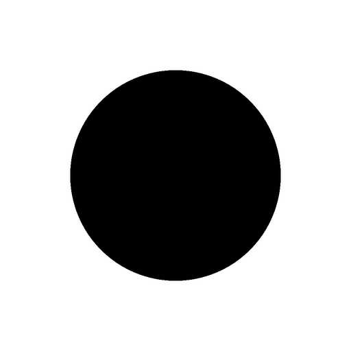  | 实心圆  | `length` 求距离、`step` 硬边界   |
| `007rectshape.frag`    | 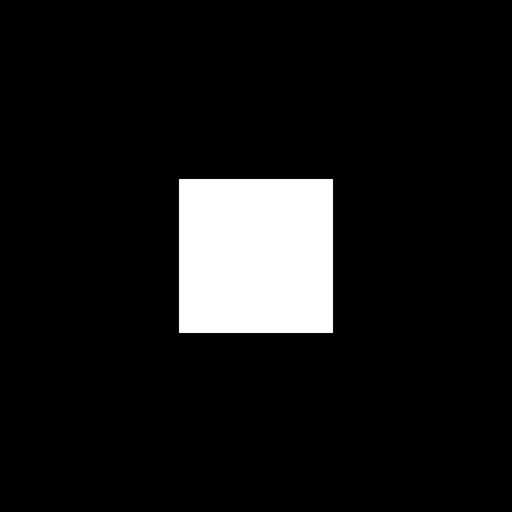    | 实心矩形 | 四条边 `step` 取乘积            |
| `008polugonshape.frag` | 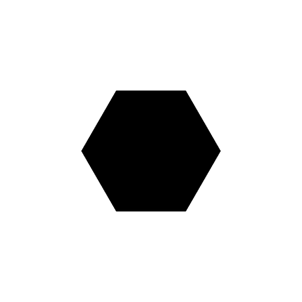 | 正多边形 | `atan` 极坐标角度、`floor` 切分扇区 |

### 3. 坐标变换

| 文件                  | 效果预览                                                   | 内容                      | 知识点               |
| ------------------- | ------------------------------------------------------ | ----------------------- | ----------------- |
| `009translate.frag` |  | 圆按固定向量平移（移出画面）          | `coord += offset` |
| `010sincos.frag`    | 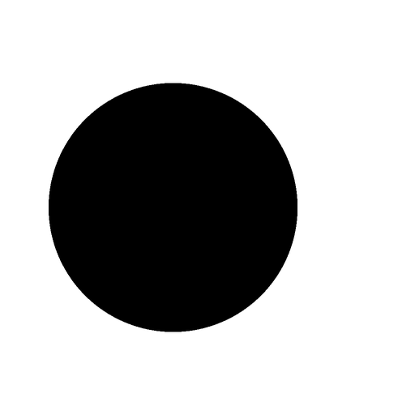    | 圆由 `sin(u_time)` 驱动左右漂移 | 时间驱动平移            |
| `011scale.frag`     | 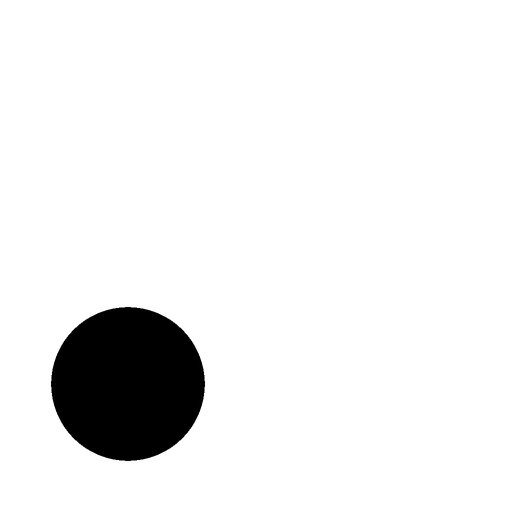     | 圆呼吸缩放                   | `mat2` 对角缩放矩阵     |
| `012rotate.frag`    | 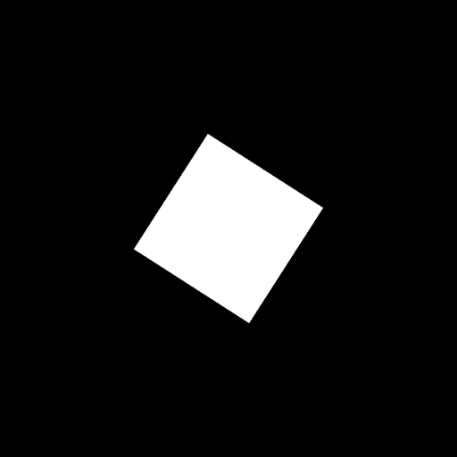    | 矩形绕中心旋转                 | 旋转矩阵、先中心化再变换      |

### 4. 程序化图案（波纹 / 域扭曲）

| 文件                     | 效果预览                                                      | 内容                       | 知识点                        |
| ---------------------- | --------------------------------------------------------- | ------------------------ | -------------------------- |
| `013warpgrid.frag`     | 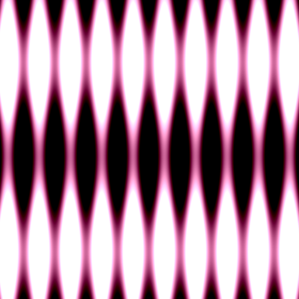     | 双正弦叠加的动态网格               | 三角函数频率叠加                   |
| `014watercolor.frag`   | 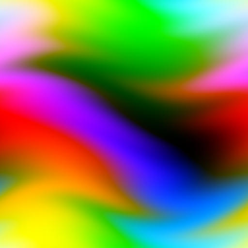   | 循环迭代坐标偏移的水彩纹理            | for 循环、嵌套 `sin`            |
| `015watercolor2.frag`  | 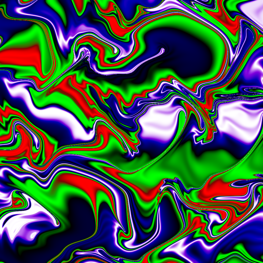  | 流体扭曲 + 径向色环              | 等比例坐标、距离 `len` 着色          |
| `015xwatercolor3.frag` | 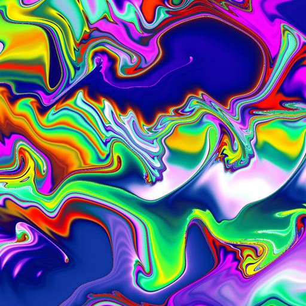 | 螺旋环与平面流体色彩混合             | 多次域扭曲迭代                    |
| `016wrapline.frag`     | 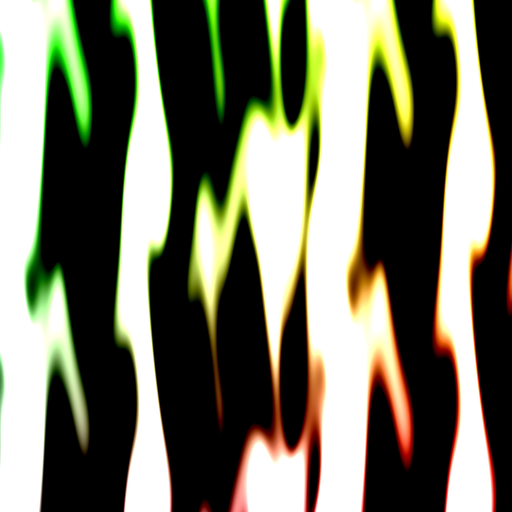     | 四重嵌套正弦 / 余弦波浪线           | 多层三角函数嵌套                   |
| `017waveline.frag`     |      | 单色波浪线，按坐标分量上色            | 嵌套 `sin`、通道拆分              |
| `018rainbowswirl.frag` | 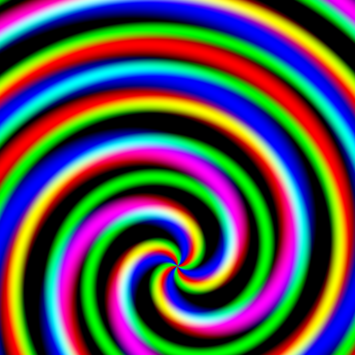 | 极坐标彩虹漩涡                  | `atan` 角度、`length` 半径、相位错位 |
| `019scanningline.frag` | 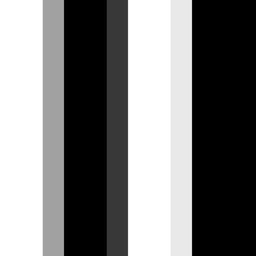 | 滚动分块扫描线                  | `floor` 分块、时间驱动 alpha      |
| `016wraplin.frag`      | 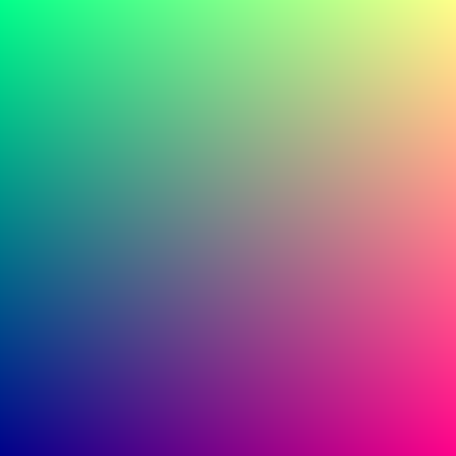      | 早期草稿，结构同 `004color.frag` | 练习残留，可忽略                   |

### 5. 噪声

| 文件          | 效果预览                                           | 内容                 | 知识点                             |
| ----------- | ---------------------------------------------- | ------------------ | ------------------------------- |
| `test.frag` |  | 流动 FBM 分形噪声 + 双色调色 | `random`、插值 `noise`、`fbm`、`mix` |

## 目录结构

```
shaderdemo/
├── 004color.frag ~ 019scanningline.frag  # 各阶段练习着色器
├── test.frag                            # FBM 噪声示例
├── screenshots/                          # 各着色器实时截图 + overview.png
├── render_screenshots.py                 # 批量渲染截图的脚本
├── GLSL_notes.md                          # 配套语法与知识点笔记
└── README.md
```

## 配套笔记

学习过程整理在 [`GLSL_notes.md`](./GLSL_notes.md)，覆盖固定骨架、数据类型、归一化坐标、形状函数、变换矩阵、域扭曲与噪声、颜色映射，以及常用内置函数速查。

## 后续方向

形状 → 变换 → 动画 → 图案 / 噪声 主链已走完，下一步：PBR 光照、光线步进（SDF / raymarching）、顶点与片元着色器协作，以及把已有效果移植到 Unity / UE5 材质。
